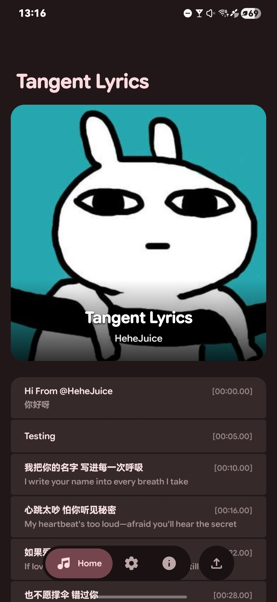
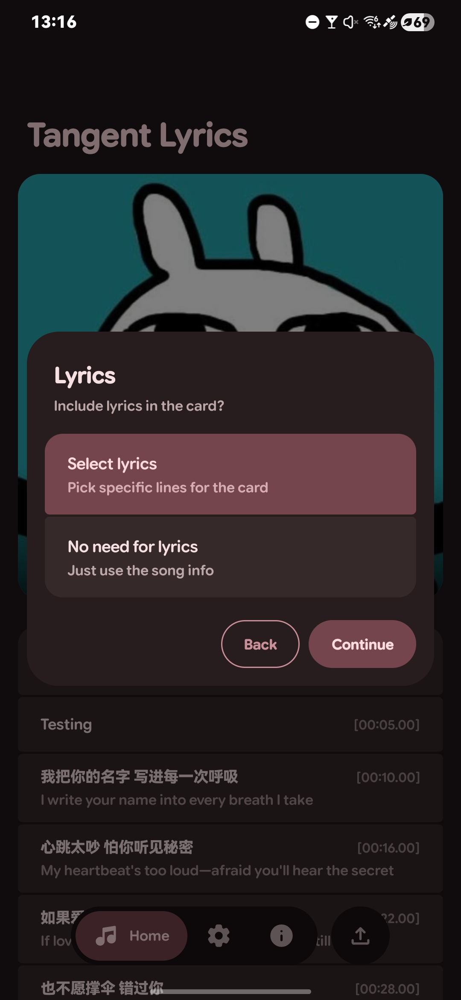
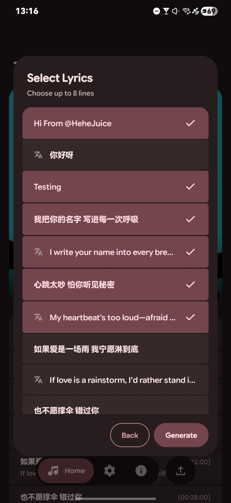
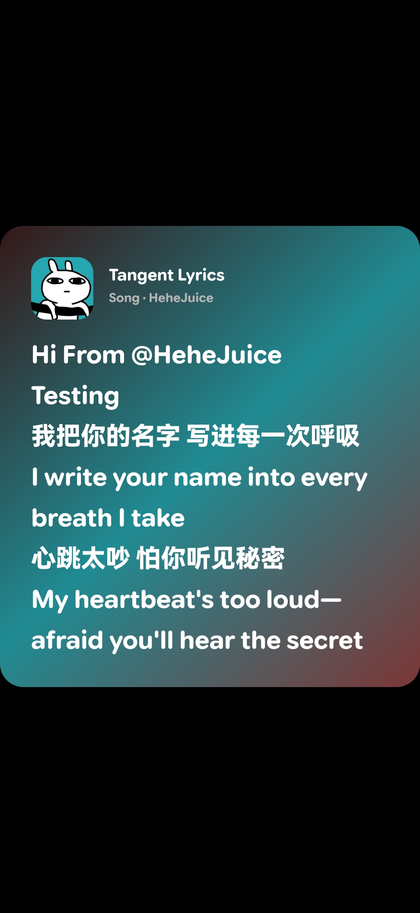

**English** · [繁體中文](README-ZH.md)

---

# Tangent Lyrics

> Turn your local music files into shareable lyric cards.

## Features

> **Local Music Parsing** — Native, zero-dependency extraction of metadata, album art, and embedded lyrics directly from your audio files.

> **Two Card Styles** — Generate standard album art cards, or lyric cards.

> **Monet Dynamic Colors** — Cards dynamically adapt their background gradients based on the album artwork.

> **Adaptive Layout** — Card width and height intelligently adjust to fit your selected lyrics perfectly.

## Screenshots

  
  
  
  

## Downloads

Download the latest APK from the [Releases page](https://github.com/HeheJuice/Tangent-Lyrics/releases).

## Open Source

This project is **Open Source** and licensed under the [GPL-3.0 License](LICENSE).

## License & Privacy

> [License (GPL-3.0)](LICENSE)
>
> [Privacy Policy](Privacy_Policy.txt)

> [!NOTE]
> You must agree to and comply with these terms when using or forwarding this content.

## Acknowledgments

<table>
  <tbody>
    <tr>
      <td width="56" align="center" valign="middle">
        
      </td>
      <td valign="middle">
        <a href="https://github.com/HeheJuice"><b>HeheJuice</b></a> 
        Developer of this app
      </td>
    </tr>
    <tr>
      <td width="56" align="center" valign="middle">
        
      </td>
      <td valign="middle">
        <a href="https://github.com/MiToverG422"><b>MiToverG422</b></a> 
        Monet color extraction assistance
      </td>
    </tr>
    <tr>
      <td width="56" align="center" valign="middle">
        
      </td>
      <td valign="middle">
        <a href="https://github.com/material-components"><b>Material Components</b></a> 
        Material Design components used in this app
      </td>
    </tr>
    <tr>
      <td width="56" align="center" valign="middle">
        
      </td>
      <td valign="middle">
        <a href="https://github.com/google"><b>Google</b></a> 
        Google Sans Flex & Material Design icons used in this app
      </td>
    </tr>
  </tbody>
</table>

## Join Us
